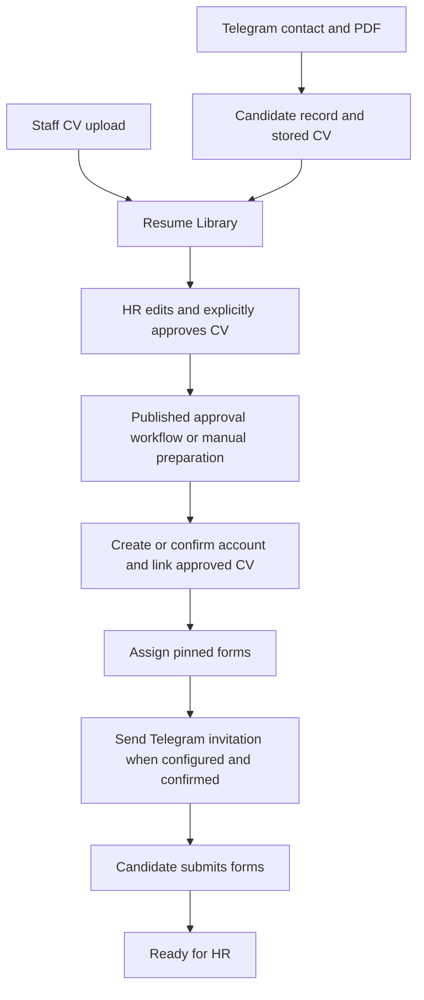

# Architecture

## Runtime and boundaries

PDF Studio uses React and TypeScript with Next App Router APIs through Vinext and Vite. Cloudflare Workers runs HTTP requests, scheduled jobs, and queue processing. This is a Worker application; changes must not assume a persistent Node server, writable production filesystem, or in-memory state that survives requests.

The browser renders management screens and recipient forms, handles interactive PDF editing, and performs supported local PDF operations. Server services enforce authorization and coordinate private data, workflows, and external providers.

| Location | Responsibility |
| --- | --- |
| `app/` | Management/public pages and API routes |
| `features/` | Domain services, components, types, and interaction helpers |
| `components/ui/` | Shared UI primitives |
| `components/patterns/` | Application shell, headings, feedback, pagination |
| `lib/auth.ts` | Better Auth setup and session integration |
| `db/schema.ts`, `db/index.ts` | Drizzle schema and D1 access |
| `drizzle/` | Ordered database migrations |
| `worker/index.ts` | HTTP request IDs, queue handlers, scheduled processing |
| `scripts/` | Build verification, evaluation, and production deployment |
| `tests/` | Node integration tests with SQLite D1 and provider mocks |

## Data and trust

D1 holds authentication, candidate/contact records, CV metadata and revisions, template versions, assignments, submissions, workflow state, audit history, and durable jobs. Private R2 holds source and completed PDFs and other stored artifacts. Browser editing drafts do not replace server approval records.

Better Auth sessions identify users; management services enforce the configured owner. Candidate intake identity is distinct from an authentication account. Recipient forms use hashed random capability tokens pinned to published template versions. Telegram webhook requests use their secret header and are durably deduplicated before processing. Never trust caller-supplied identity headers.

## Candidate lifecycle

This diagram shows the preparation path; workflows can also start on Telegram submission or staff upload and wait for review. Review-only workflows can end without creating accounts or assigning forms. Paid AI is optional and initiated only through the Resume Editor, outside automatic intake/workflow execution. See [workflow behavior](candidate-workflows.md) and [Telegram intake](telegram-candidate-intake.md).

Progress combines current CV approval, selected preparation, actual invitation evidence, required submissions, and audited HR stage overrides. Kanban moves do not perform the underlying business actions. See [Candidate Progress](candidate-progress.md).

## Durable processing

The Worker queue processes AI field-detection jobs. Scheduled processing drains Telegram inbox work, resumes candidate workflows, and retries storage cleanup. Telegram webhook handling also schedules background inbox processing after acknowledgement.

Workflow graphs and approved preparation values are snapshotted. Lease checks, revision guards, unique constraints, and D1 batches protect against concurrent workers/reviewers and duplicate account or form creation. External Telegram sends track uncertainty separately from known failure. Archive retains related evidence; eligible permanent deletion enqueues R2 cleanup transactionally. See [Archive](archive.md).

## Development and production

[README](../README.md) documents local installation and configuration. `wrangler.dev.jsonc` supplies local emulation; it is not a staging deployment target. Production configuration lives in Wrangler and GitHub deployment settings, with secrets kept outside source control.

`.github/workflows/deploy-production.yml` runs on pushes to `codex/pdf-studio-self-host` or manual dispatch. It uses Node 22, installs locked dependencies, checks lint/types/migrations/tests, and invokes `scripts/deploy-production.mjs`. Deployment applies production migrations, publishes the Worker, and runs authenticated smoke checks; Telegram registration is verified when its required secrets are available. Application deployment success alone does not prove Telegram configuration when registration was skipped.

There is currently one production target. `main` is not the application deployment branch. See [decisions](decisions.md) before changing these assumptions.

The additive [web form builder](form-builder.md) lives in `features/forms`, with `/forms` management routes and shared `/fill` account authorization. It uses versioned template storage and existing assignment/workflow history, with separate draft-response and leased PDF-artifact tables. Legacy PDF templates continue to use their existing editor.

[HR workspace](hr-workspace.md) adds task-based Home and unified profiles. Submission reviews are separate records; correction requests rotate the existing assignment to a new link in a guarded batch while retaining immutable submission/version history.

## Needs attention queue (shipped October 2026)

`/needs-attention` is the owner-scoped daily task page under Candidates. It combines the existing evidence-based candidate progress model, active unlinked staff CVs and pending owned form submissions. HR Home uses the same task source for counts, the first 20 tasks and direct action destinations. The page supports search, issue type, priority/oldest order and 25-task pagination. Filters persist per owner in URL/session storage; refresh runs every minute and retains the last loaded tasks on failure.

CV review and CV update tasks open the editor. Contact/setup tasks reuse existing confirmation and execution screens. Failed runs open their saved execution; archived runs are excluded. Pending active assignments include preserved form history, while cancelled/expired assignments remain separate blockers. Each unreviewed submission opens its existing HR review screen; accepted/correction-requested and archived submissions are excluded. A candidate can have multiple independent tasks. Manual Kanban stages do not replace operational evidence.

Waiting clocks use CV receipt, update receipt, assignment and submission timestamps. Contact waits use recorded approval when available. Failed runs show Last run update rather than inventing a failure start time; missing evidence remains unknown. Waiting forms are not labelled overdue and no reminders, resends, approvals, workflow runs or AI processing occur when opening this page. Task actions navigate to existing guarded operations.
